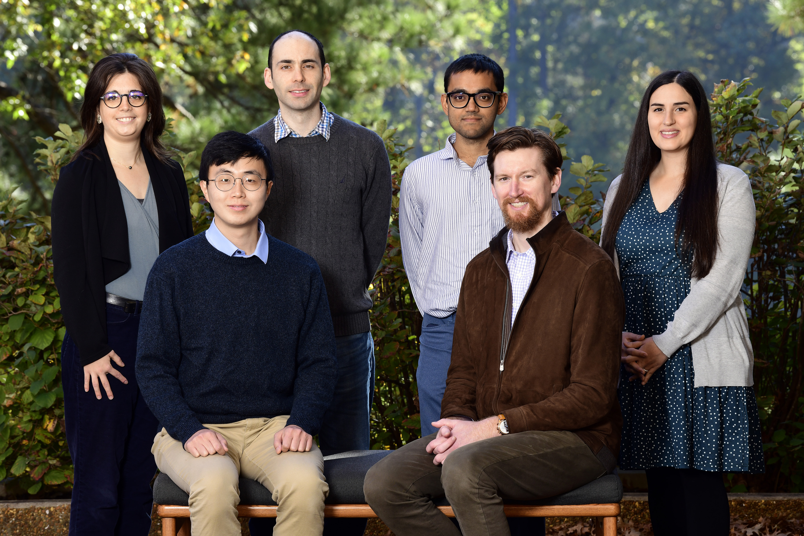

{width="75%"}

# Group Lead

## Kyle P Messier, PhD {#KPM}

![Kyle P Messier is a Stadtman Tenure-Track Investigator at the National Institute of Environmental Health Sciences (NIEHS) in the Division of Translational Toxicology (DTT). He leads the Spatiotemporal Exposures and Toxicology group, {SET}grp, within the Predictive Toxicology Branch. He also holds a joint appointment with the National Institute of Minority Health and Health Disparities (NIMHD) in Bethesda, Maryland and a secondary appointment in the NIEHS Biostatistics and Computational Biology Branch. Messier received a B.S. in Environmental Studies from the University of North Carolina at Asheville and a M.S. and Ph.D. from the University of North Carolina at Chapel Hill.](images/KPM-headshot-Oct2023.jpg){width="30%"}

# Postdoctoral Fellows and Contractors

## Paul Kruse {#PK}

{width="20%"}

## Austin Rau {#AR}

{width="21%"}

##  Kate Goodrich {#KG}

{width="21%"}

##  Zach Stanfield {#ZS}

![Dr. Zachary Stanfield is an environmental data scientist with experience in air pollution exposure modeling, consumer product exposures, new approach methods (NAMs), machine learning, and data mining. He holds a BS in Physics from North Carolina State University and a PhD in Systems Biology and Bioinformatics from Case Western Reserve University. Currently, he is working on a reproducible pipeline for spatio-temporal mapping of hazardous air pollutants across the US using Bayesian hierarchical modeling.]()

# Former Members {#FormerMembers}

1.  [Kristin Eccles](https://kristineccles.wordpress.com/), Postdoctoral Fellow, Now at Health Canada

2.  [Melissa Lowe](https://www.linkedin.com/in/melissa-lowe-1a62a8b3/), Postbaccalaureate Fellow, Now at Duke Cancer Institute

3.  Taylor A Potter, Postbaccalaureate Fellow, Now in medical school at Meherry Medical College

4.  [Alvin Sheng](https://bjreich.wordpress.ncsu.edu/students-post-docs/), Summer Intern (2021), Currently a 5th year PhD Student in Statistics at North Carolina State University

5. [Daniel Zilber](https://www.niehs.nih.gov/research/atniehs/labs/bb/staff), Postdoctoral Fellow, Now a Staff Scientist at NIEHS with Shanshan Zhao in the Biostatistics and Computational Biology Branch

6. Ranadeep Daw, Postdoctoral Fellow, Now a tenure-track Assistant Professor at the University of West Florida in the Department of Mathematics and Statistics

7. [Insang Song](https://sigmafelix.wixsite.com/mysite/), Now a tenure-track Assistant Professor in the Department of Geography at Seoul National University, Korea

8. [Mitchell Manware](), Data Analyst, Now a PhD Student at Yale School of Public Health, Environmental Health Sciences

9. [Mariana Alifa](https://www.enverus.com/), IRTA Postdoctoral Fellow, Now a Data Scientist at Enverus

10. [Eva Marques](), Visiting Postdoctoral Fellow, Now a Federal Engineer for Meteorology at the Ministry of Ecology, Biodiversity, Forests, and Fisheries (France)